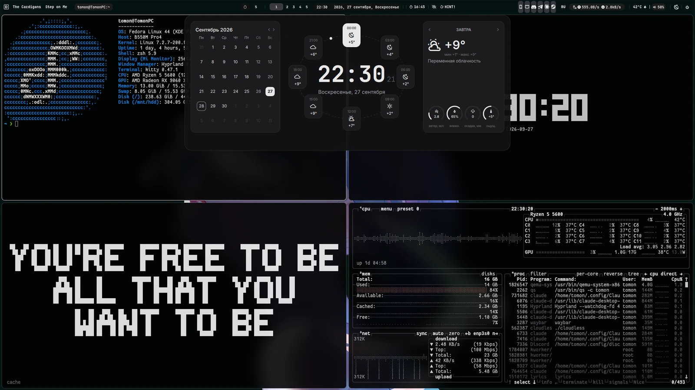
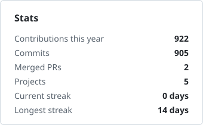
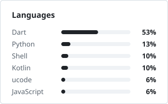
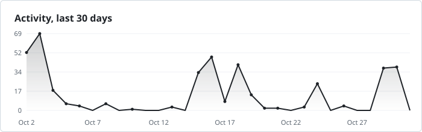

  

  
  
  
  
  
  
   
  
  
  
  
   main stack · also used

---

### About

- When something I need is missing, or the existing tools don't suit me, I just write my own. That's how **[cloudless](https://github.com/tomon-one/cloudless)**, **Pereliv**, **[byway](https://github.com/tomon-one/byway)** and **[Kogda Para?](https://github.com/tomon-one/kogda-para)** came to be
- Studying to be a system administrator
- My PC is mostly for music and work
- Monochrome, minimalism, and everything tuned to the last pixel
- Playing Cyberpunk 2077 again: a netrunner with a katana

### Now

- **[Kogda Para?](https://github.com/tomon-one/kogda-para/releases/tag/r-%D0%92%D0%B8%D1%82%D0%B8%D0%BC.1.2.2)** 1.2.2 "Vitim" is out: nearly 80 changes in 12 days, a new schedule and widget design, a day strip for jumping around the week, a "Glass" theme in beta, and quiet hours 22–07 with a single morning digest. News at [t.me/kogda_para_news](https://t.me/kogda_para_news)
- **[byway](https://github.com/tomon-one/byway/releases/tag/v0.4.0)** 0.4.0 "Ice Road" is out: rewritten in ucode, over a hundred fixes, and home DNS no longer goes dark if byway fails to start
- **[claude-desktop-presence](https://github.com/tomon-one/claude-desktop-presence/releases/tag/v0.2.0)** 0.2.0 "Afterlife": Discord shows what Claude Desktop is up to, with 181 easter eggs instead of "Thinking", 104 of them from Night City
- **Pereliv**, my new music player for Linux and Android, is in early development: it blends tracks at the join and keeps them at the same loudness. Its predecessor, [Cloudless](https://github.com/tomon-one/cloudless), is archived
- Writing about all of it in **[/dev/tomon](https://t.me/dev_tomon)** (in Russian)

### Setup

  

  Fedora 44 · Hyprland (Lua config) · custom Quickshell shell · kitty + zsh 
  Ryzen 5 5600 · RX 9060 XT · 16 GB (single channel, long story) · 1440p @ 200 Hz

### Activity

  <picture>
    <source media="(prefers-color-scheme: dark)" srcset="cards/stats-dark.svg">
    
  </picture>
  <picture>
    <source media="(prefers-color-scheme: dark)" srcset="cards/langs-dark.svg">
    
  </picture>

  <picture>
    <source media="(prefers-color-scheme: dark)" srcset="cards/activity-dark.svg">
    
  </picture>

  <picture>
    <source media="(prefers-color-scheme: dark)" srcset="https://raw.githubusercontent.com/tomon-one/tomon-one/output/snake-dark.svg">
    
  </picture>

 

  
  
  

  Built long before daylight

