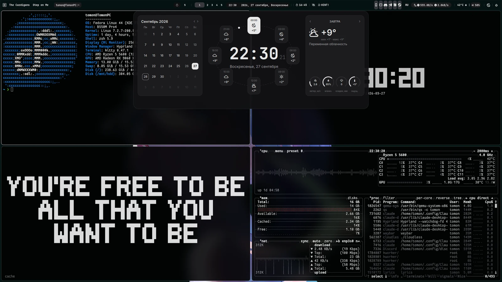
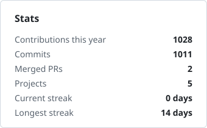
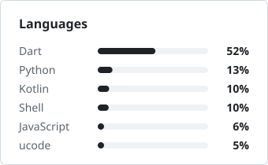
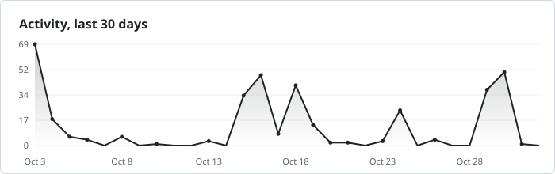

  

  
  
  
  
  
  
   
  
  
  
  
   main stack · also used

---

### About

- When something I need is missing, or the existing tools don't suit me, I just write my own. That's how **[cloudless](https://github.com/tomon-one/cloudless)**, **Pereliv**, **[byway](https://github.com/tomon-one/byway)**, **[Kogda Para?](https://github.com/tomon-one/kogda-para)** and **[Build Shard](https://www.nexusmods.com/cyberpunk2077/mods/36822)** came to be
- Studying to be a system administrator
- My PC is mostly for music and work
- Monochrome, minimalism, and everything tuned to the last pixel
- Playing Cyberpunk 2077 again, over 15 runs in: a netrunner with a katana, and now modding it too

### Now

- **[Build Shard](https://www.nexusmods.com/cyberpunk2077/mods/36822)** 1.0.0 is out, my first Cyberpunk 2077 mod: it labels your next perk and attribute right in the game menus, and you can plan a whole build on the perk screen without spending a point
- **[Kogda Para?](https://github.com/tomon-one/kogda-para/releases/tag/r-%D0%92%D0%B8%D1%82%D0%B8%D0%BC.1.2.2)** 1.2.2 "Vitim" is out: nearly 80 changes in 12 days, a new schedule and widget design, a day strip for jumping around the week, a "Glass" theme in beta, and quiet hours 22–07 with a single morning digest. News at [t.me/kogda_para_news](https://t.me/kogda_para_news)
- **[byway](https://github.com/tomon-one/byway/releases/tag/v0.4.0)** 0.4.0 "Ice Road" is out: rewritten in ucode, over a hundred fixes, and home DNS no longer goes dark if byway fails to start
- **[claude-desktop-presence](https://github.com/tomon-one/claude-desktop-presence/releases/tag/v0.2.0)** 0.2.0 "Afterlife": Discord shows what Claude Desktop is up to, with 181 easter eggs instead of "Thinking", 104 of them from Night City
- **Pereliv**, my new music player for Linux and Android, is in early development: it blends tracks at the join and keeps them at the same loudness. Its predecessor, [Cloudless](https://github.com/tomon-one/cloudless), is archived
- Writing about all of it in **[/dev/tomon](https://t.me/dev_tomon)** (in Russian)

### Setup

  

  Fedora 44 · Hyprland (Lua config) · custom Quickshell shell · kitty + zsh 
  Ryzen 5 5600 · RX 9060 XT · 16 GB (single channel, long story) · 1440p @ 200 Hz

### Activity

  <picture>
    <source media="(prefers-color-scheme: dark)" srcset="cards/stats-dark.svg">
    
  </picture>
  <picture>
    <source media="(prefers-color-scheme: dark)" srcset="cards/langs-dark.svg">
    
  </picture>

  <picture>
    <source media="(prefers-color-scheme: dark)" srcset="cards/activity-dark.svg">
    
  </picture>

  <picture>
    <source media="(prefers-color-scheme: dark)" srcset="https://raw.githubusercontent.com/tomon-one/tomon-one/output/snake-dark.svg">
    
  </picture>

 

  
  
  <a href="https://www.nexusmods.com/profile/Tomon0"><img src="https://img.shields.io/badge/Nexus%20Mods%20%C2%B7%20Tomon0-000?style=flat-square&logo=data%3Aimage%2Fsvg%2Bxml%3Bbase64%2CPHN2ZyBmaWxsPSIjZmZmIiByb2xlPSJpbWciIHZpZXdCb3g9IjAgMCAyNCAyNCIgeG1sbnM9Imh0dHA6Ly93d3cudzMub3JnLzIwMDAvc3ZnIj48dGl0bGU%2BTmV4dXMgTW9kczwvdGl0bGU%2BPHBhdGggZD0iTTE3LjM3NiAwYy0uOTkzIDAtMi4xOC42ODYtMi45MDcgMS4xODItMS42NzYtLjM2LTQuMDM2LS41NDUtNi43ODcuNjM1LTEuMzY1LS41MTMtMi40MjUtLjU2Mi0zLjMyLS40ODhhMi4xNiAyLjE2IDAgMCAwLTEuMjcuNDI5Yy0uMzMuMjItMi43ODggMi42OS0zLjA2OSA0LjY1MkMtLjE1IDcuNTA4LjY4IDguOTMyIDEuMjE4IDkuNzE4Yy0uNDQgMS43Ni0uMiA0LjU3Mi41MTcgNi4xODgtLjM1MyAxLjA0MS0uNzEzIDIuMDg5LS42NjQgMy4yMDUuMDEuNTg0LjA2MSAxLjE4OC4zOTggMS42ODRDMS43MiAyMS4xOSA0LjUyOCAyNCA2LjU0NSAyNGMuOTU3IDAgMS45My0uNDI4IDMuMDctMS4yNCAyLjE2LjM4MyA0LjQwMi4zNDggNi40NDgtLjUzMiAyLjU3MyAxLjAwMSA0LjIyNC42MjUgNC44NC4xNjIuNTg3LS40NTcgMi44MjYtMi45MTUgMy4wNy00LjYyMi4xLS42NzItLjAyMy0xLjYzOC0xLjIyNi0zLjM5N2ExMC45ODMgMTAuOTgzIDAgMCAwLS41MDEtNi40NTVjLjM5Ni0xLjA2OS42NzMtMi4xODguNTktMy4zMzctLjAxNS0uNjgtLjIyMS0xLjE2Ny0uNDg3LTEuNTA3LS4yMDktLjMzNS0yLjQxNS0yLjM5LTQuMDI4LTIuOTFBMy4xMDUgMy4xMDUgMCAwIDAgMTcuMzc2IDBtLS4wMyAyLjA4MmMuNjUuMDE1IDIuMTU1IDEuMDkzIDMuMDEgMS45MDZsLjM1NS4zNGMtLjk1OS0uMTYzLTIuMTI1LjQyOC0zLjI2IDEuNTVhMTAuMjggMTAuMjggMCAwIDAtMS4zNTggMS41OTVjLS4yOC4zODQtLjUxNy43NjgtLjc1MyAxLjI4NWwxLjE4LjYzNS0zLjg5NSAxLjQ3Ny0xLjEyMi00LjE4IDEuMDMzLjU0N2MxLjM1OC0zLjEwMiAyLjUyNC0zLjk3MyAzLjIzMi00LjQxNmguMDE1YTUuMTIgNS4xMiAwIDAgMSAxLjQ5LS43MjR6TTEyIDMuMDY1YTguOTMyIDguOTMyIDAgMCAxIDIuMjIuMjc5IDcuNjcgNy42NyAwIDAgMC0uNDIuNDg4IDguNDAzIDguNDAzIDAgMCAwLTEuOC0uMTk2IDguMzM2IDguMzM2IDAgMCAwLTUuODk3IDIuNDMyIDcuODYgNy44NiAwIDAgMS0uMzctLjQzM0E4LjkwNSA4LjkwNSAwIDAgMSAxMiAzLjA2NW0tNy4wNzYuMzA1Yy43MS0uMDAyIDEuMzA5LjEyNyAyLjIuNDY2YTkuNTI2IDkuNTI2IDAgMCAwLTEuNzEzIDEuMzM3Yy0uMzI3LS41NDItLjYyNC0xLjE1Ni0uNDg4LTEuODAzbS0uNjA2LjA0MmMtLjE2Mi45Ni40MjggMi4xMjYgMS41NSAzLjI2NC40NTcuNDg3IDEuMDAzLjk0NSAxLjU5NCAxLjM1OC4zODMuMjgxLjc2Ny41MTcgMS4yODMuNzU0bC42Mi0xLjE4MiAxLjQ5IDMuOTE0LTQuMTc2IDEuMTIyLjU0Ni0xLjAzM2MtMy4wOTktMS4zNi0zLjk2OS0yLjUyNi00LjQxMi0zLjIzNXYtLjAxNWE1LjE0NCA1LjE0NCAwIDAgMS0uNzIzLTEuNDkxbC0uMDE1LS4wNzRjLjAxNS0uNjUgMS4wOTItMi4xNTYgMS45MDQtMy4wMTNabTE2LjAzNSAxLjQ4M2ExLjI1OSAxLjI1OSAwIDAgMSAuMjYuMDE1bC4xNC4wMjNhNS4wNSA1LjA1IDAgMCAxLS4xMyAxLjEzN3YuMDE1Yy0uMS4zODMtLjIyOC43NjUtLjM3NyAxLjE0OGE5LjUyNiA5LjUyNiAwIDAgMC0xLjM0Ni0xLjc3NmMuNTQ3LS4zNTcgMS4wNTEtLjU0NiAxLjQ1My0uNTYyTTE4LjQzIDUuOGE4LjkwMyA4LjkwMyAwIDAgMSAyLjUwNiA2LjIgOC45MzcgOC45MzcgMCAwIDEtLjI3IDIuMTgzIDcuNjU4IDcuNjU4IDAgMCAwLS40ODgtLjQyNUE4LjQwNyA4LjQwNyAwIDAgMCAyMC4zNjQgMTIgOC4zMzQgOC4zMzQgMCAwIDAgMTggNi4xNzNhNy45MDQgNy45MDQgMCAwIDEgLjQyOS0uMzczTTMuMzE1IDkuOTA1Yy4xNTcuMTQ4LjMxOS4yOS40ODguNDI1QTguNDE3IDguNDE3IDAgMCAwIDMuNjM2IDEyYzAgMi4yNDguODg3IDQuMjg2IDIuMzI3IDUuNzg4YTguMTEgOC4xMSAwIDAgMS0uNDI2LjM3NkE4LjkwMiA4LjkwMiAwIDAgMSAzLjA2NSAxMmE4LjkzNyA4LjkzNyAwIDAgMSAuMjUtMi4wOTVtMTMuOTg4IDEuNTQxLS41NDYgMS4wMzRjMy4wOTggMS4zNTkgMy45NjkgMi41MjYgNC40MTIgMy4yMzV2LjAxNGMuMzQuNDg4LjU3NS45OS43MjMgMS40OTJsLjAxNC4wNzRjLS4wMTQuNjUtMS4wOTIgMi4xNTYtMS45MDMgMy4wMTNsLS4zNC4zNTRjLjE2My0uOTYtLjQyNy0yLjEyNy0xLjU0OS0zLjI2NGExMC4yOTggMTAuMjk4IDAgMCAwLTEuNTk0LTEuMzU5IDcuMDA4IDcuMDA4IDAgMCAwLTEuMjgzLS43NTNsLS42MDUgMS4xNTItMS41MDUtMy44N3ptLTYuMDA2IDEuNjg0IDEuMTIxIDQuMTgtMS4wMzMtLjU0N2MtMS4zNTcgMy4xMDItMi41MjMgMy45NzMtMy4yMzEgNC40MTZoLS4wMTVjLS40ODcuMzQtLjk4OS41NzYtMS40OS43MjRsLS4wNzQuMDE1Yy0uNjUtLjAxNS0yLjE1NC0xLjA5My0zLjAxLTEuOTA2bC0uMzU0LS4zNGMuOTU5LjE2MyAyLjEyNC0uNDI4IDMuMjYtMS41NS40ODgtLjQ1OC45NDUtMS4wMDQgMS4zNTgtMS41OTUuMjgtLjM4NC41MTctLjc2OC43NTMtMS4yODVsLTEuMTY2LS42MzVaTTMuNzIgMTYuNjYzQTkuNTI2IDkuNTI2IDAgMCAwIDUuMDg2IDE4LjVjLS42OTcuNDctMS4zMy42NjUtMS43NzcuNTlsLS4xMzgtLjAyNGMwLS4zNjcuMDM4LS43NDguMTI4LTEuMTM3di0uMDE1Yy4xMS0uNDE3LjI1NC0uODM1LjQyLTEuMjUybTE0LjEzMSAxLjMxNGMuMTI5LjE0LjI1My4yODMuMzcyLjQzQTguOTA0IDguOTA0IDAgMCAxIDEyIDIwLjkzNmE4LjkzMiA4LjkzMiAwIDAgMS0yLjI4Mi0uMjk2IDcuNzU3IDcuNzU3IDAgMCAwIC40MTctLjQ4NyA4LjMzNSA4LjMzNSAwIDAgMCA3LjcxNi0yLjE3NW0uNjk2Ljg4OWMuNDMuNjY2LjYwNyAxLjI2Ny41MzQgMS42OThsLS4wMjMuMTM4YTUuMDM0IDUuMDM0IDAgMCAxLTEuMTM2LS4xMjhoLS4wMTRhMTAuNzE4IDEwLjcxOCAwIDAgMS0xLjExNC0uMzY2IDkuNTI2IDkuNTI2IDAgMCAwIDEuNzUzLTEuMzQyIi8%2BPC9zdmc%2B" alt="Nexus Mods: Tomon0"></a>
  

  Built long before daylight

